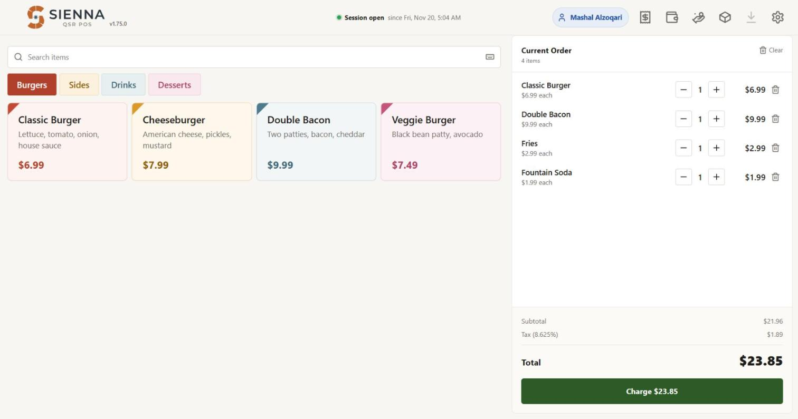
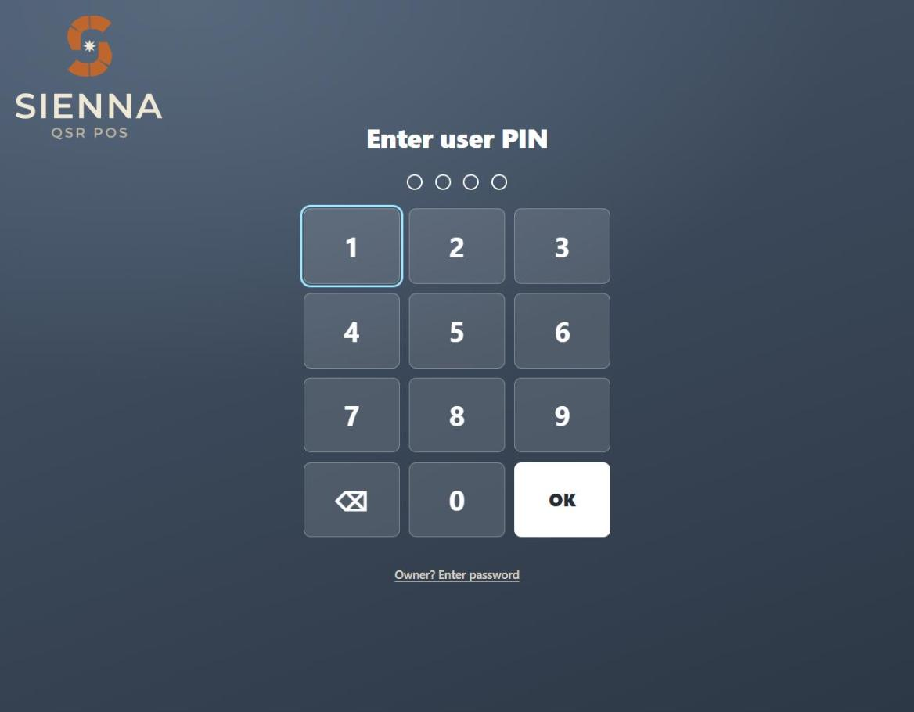

# Hi, I'm Mashal 👋

**CS student @ York College (CUNY) · Data Science Fellow @ CUNY Tech Prep (Cohort 12) · Queens, NY**

I build software for independent food operators: point-of-sale, workforce and inventory tools, designed from real experience working in my family's deli and grocery.

> My production codebases are proprietary and kept private. This page shows what they do and how they're built. Happy to walk through architecture or do a code review session on request.

---

## 🧾 Sienna QSR: offline-first POS for quick-service restaurants
**Live:** [sienna-qsr.web.app](https://sienna-qsr.web.app/)

- Installable **PWA** with a versioned service-worker precache: works fully offline, and updates wait for the cashier so the register never reloads mid-sale
- Order history in **IndexedDB**, with ticket numbers assigned inside the same transaction as the insert
- **Correct money:** all amounts are integer cents, and tax is kept as an exact fraction with half-up rounding
- Owner accounts via **Firebase Auth** (Google sign-in), locked down with Firestore security rules
- Per-store **Stripe** subscription billing (Checkout, Customer Portal, webhooks) through custom **Cloud Functions**
- Strict CSP (no inline script or style, no `innerHTML`), plus accessible, touch-first UI: focus management, screen-reader announcements, AA contrast

`JavaScript (ES modules)` `Firebase` `Stripe` `IndexedDB` `Service Workers`

## ⏱️ CremePunch: kiosk time, attendance & payroll SaaS (v1.2.6)
Built to solve scheduling and payroll at a small hourly-staffed shop. It **cut weekly payroll processing time by ~80%**.

- **React 19 + TypeScript + Vite**, with a layered architecture (pages → storage → utils → types)
- **Offline-first multi-device sync:** each device runs on a local cache, and a debounced sync engine mirrors changes to Cloud Firestore, with store-switch safety so data never leaks across licenses
- **Cloud Functions** for license issuance/activation, kiosk designation and cloud backups, with live license revocation
- Payroll reconciliation wizard with Excel export, scheduled-vs-actual reports, overtime and late/no-show alerts
- PINs hashed with the Web Crypto API; admin idle timeout and lockout recovery

`React` `TypeScript` `Vite` `Firebase (Auth, Firestore, Functions, Storage, Hosting)` `Workbox` `SheetJS`

## 📦 Inventory Manager: purchase order & supplier PWA
Replaced clipboard vendor ordering with digital POs, supplier cutoff times, an upcoming-orders view and PO history, with export to Excel.

## ♿ Accessibility Copilot: CUNY Tech Prep Hackathon (Summer 2026)
A team-built tool that helps UI developers bring their websites up to accessibility standards.

---

### 🛠️ Toolbox
**Languages:** TypeScript · JavaScript · Python · C++ · HTML/CSS 
**Frontend:** React · Vite · PWAs / Service Workers · IndexedDB 
**Backend & cloud:** Firebase (Auth, Firestore, Cloud Functions, Storage, Hosting) · Stripe 
**Data:** Python · Jupyter (CUNY Tech Prep Data Science track)

### 📫 Connect
[LinkedIn](https://www.linkedin.com/in/mashal-alzoqari-489447187/)
